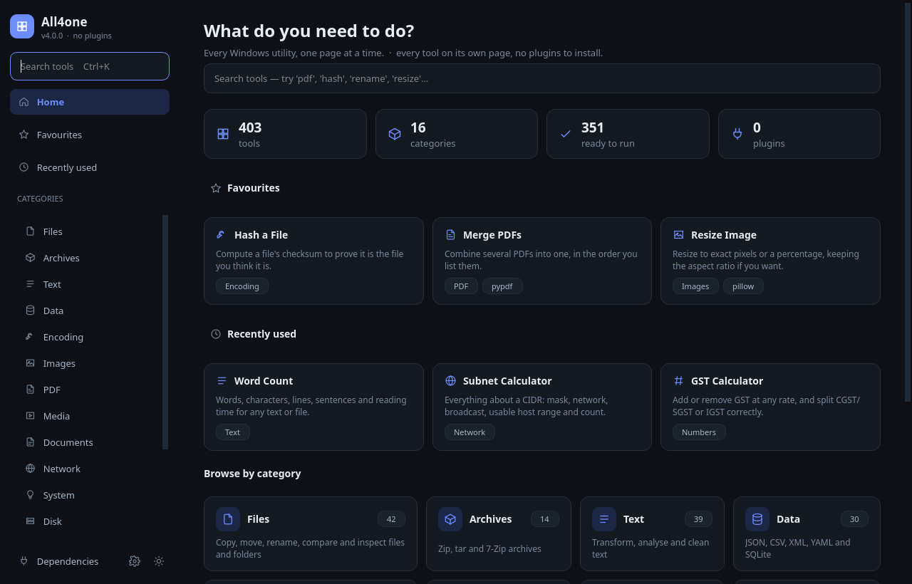
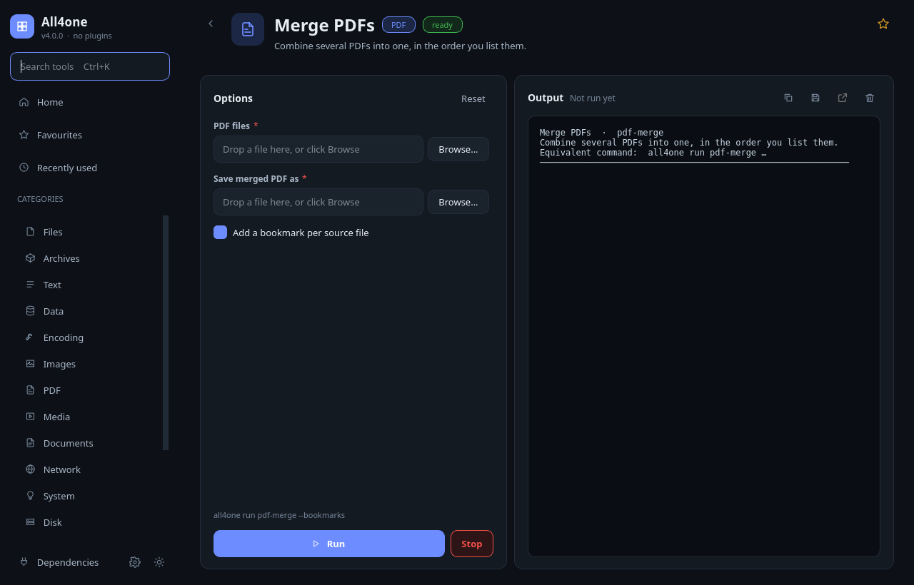
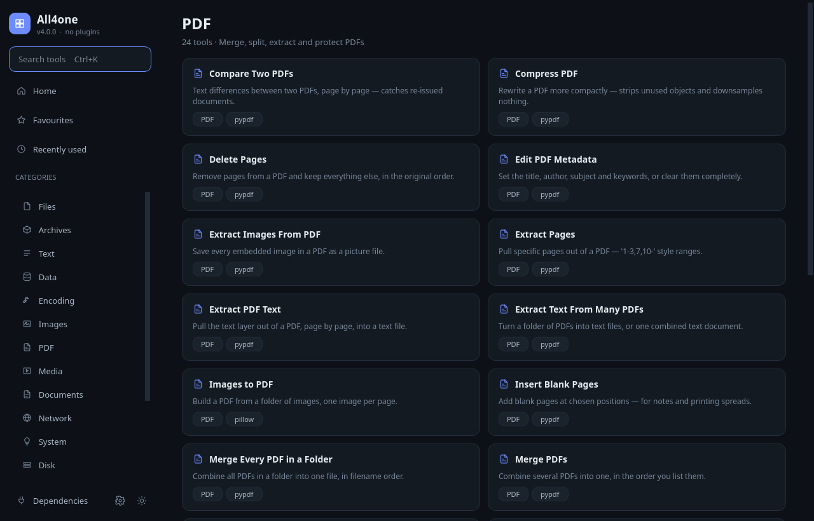
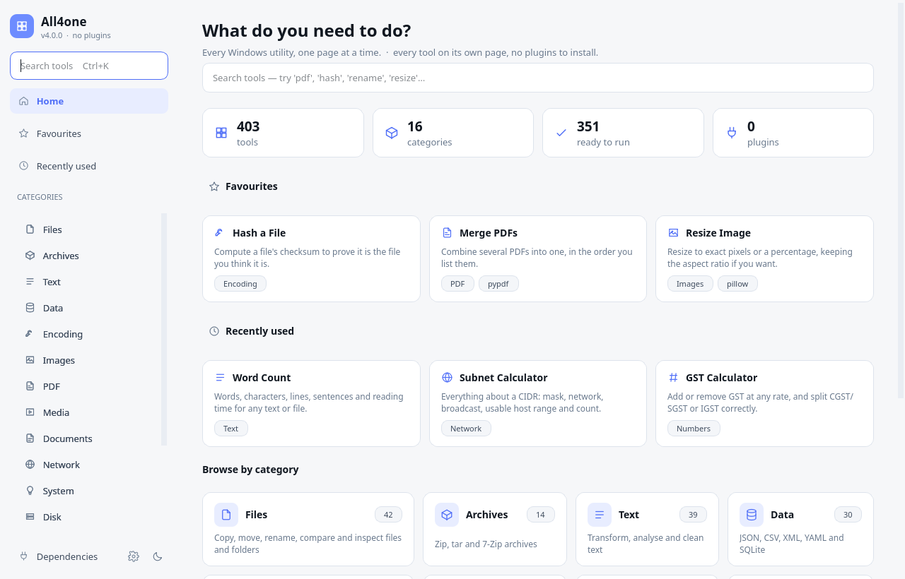

<div align="center">

# All4one

### 403 working tools. One portable binary. No plugins, no packs, no filler.

Every tool gets its own page with its own options — search it, open it, set what you need, run it.


**🌐 [Landing page](https://drsamonline.github.io/All4ONE/)** · **🖼️ [Screenshots](#-what-it-looks-like)** · **📚 [All 403 tools](TOOL_CATALOG.md)** · **⬇️ [Download](https://github.com/drsamonline/All4ONE/releases)**

</div>

---

## What this is

A rebuilt utility suite for Windows: file and folder work, text and data, encoding and
hashing, images, PDFs, media, documents, network diagnostics, system and disk
maintenance, developer helpers, security checks, calculators and generators — in a
single executable that needs no installer, writes nothing to the registry, and runs
off a USB stick.

It is a rewrite, not a reskin. The previous version registered 551 tools across 45
plugin packs behind one dense table; a large share of those were thin adapters with
near-duplicate behaviour ("Image Cropper — Crop image.", "Sparse File Inspector —
report internals"). That architecture is gone:

| | Before (3.x) | Now (4.0) |
|---|---|---|
| Structure | 45 plugin packs, a Packs tab, enable/disable toggles | One flat catalogue — nothing to enable, nothing to install |
| Tools | 551 registered, many trivial or duplicated | 403, each with a real implementation and its own options |
| UI | Tkinter, one table + details pane for everything | Qt (PySide6), sidebar navigation, one page per tool |
| Options | Free-text argument box | Typed controls generated from each tool's own schema |
| Verification | Registry smoke test only | Every runnable tool executed against fixtures on every build |

Nothing was kept just to keep the count up. Every tool listed in
[TOOL_CATALOG.md](TOOL_CATALOG.md) runs, and the sweep that proves it ships with the
repository.

## What it looks like

| Home | A tool page |
|---|---|
|  |  |

| Category listing | Light theme |
|---|---|
|  |  |

## How it works

**Sidebar.** Home, Favourites, Recently used, then every category with a live count.
Dependencies and Settings sit at the bottom; the sun/moon button switches theme.

**Search.** `Ctrl+K` from anywhere. Results are ranked on name, category, summary and
keywords — typing "split" finds PDF splitting, file splitting and text splitting.

**A tool page.** The header carries the tool's name, category, readiness and a
star for favourites. On the left, the options: text boxes, dropdowns, numbers,
colour pickers, toggles, and file/folder pickers that accept drag-and-drop. On the
right, the output console: streaming lines as the tool works, a progress bar when the
tool reports progress, and buttons to copy, save or open whatever the tool produced.

**Running.** `Ctrl+Enter` runs. Long jobs stream and can be stopped. Tools that change
or delete data ask first, and show a red badge on their page.

**Readiness, not gatekeeping.** A tool that needs FFmpeg, Tesseract or a Python
package is still listed; it says what is missing and how to get it. Nothing is hidden
and nothing silently fails.

## Quick start

### The portable build

Download `All4one-4.0.0-windows.zip` from
[Releases](https://github.com/drsamonline/All4ONE/releases), unzip, run
`All4one.exe`. That is the whole installation.

### From source

```bash
git clone https://github.com/drsamonline/All4ONE.git
cd All4ONE
pip install PySide6          # only needed for the desktop UI
python main.py               # desktop app
python main.py list          # every tool, by category
```

The engine and every standard-library tool run on bare Python — PySide6 is only for
the window.

## Command line

The same binary is a proper CLI, and every GUI option has an identical flag:

```powershell
all4one list                                  # all 403 tools, grouped
all4one list --category PDF                   # one category
all4one search hash                           # ranked search
all4one show pdf-merge                        # options, defaults, readiness
all4one run hash-file --file report.pdf --algorithm sha256
all4one run gst-calc --amount 10000 --rate 18
all4one run pdf-extract-pages --file book.pdf --pages "1-3,7" --output ch1.pdf
all4one deps                                  # what optional extras are installed
```

Options come from the tool's own field definitions, so the CLI can never drift from
the UI. Boolean options are `--flag` / `--no-flag`.

## Optional dependencies

The app and 380 of the tools run on the Python standard library alone. The rest
declare what they need and light up when it is present:

| Needs | Unlocks |
|---|---|
| Pillow | 26 image tools |
| pypdf | 24 PDF tools |
| FFmpeg / ffprobe | 20 media tools |
| openpyxl · python-docx | 15 document tools |
| Tesseract · Poppler | OCR and PDF-to-image |
| 7-Zip · LibreOffice · git | archive, office conversion, git tools |
| cryptography | file encryption |
| pywin32 | the Windows API tools |

Run `all4one deps` — or open **Dependencies** in the app — for the exact install
line for each one.

## Architecture

```text
main.py                  entry point: no arguments opens the UI, else the CLI
core/
  tool.py                the contract — a tool is a function + a field schema
  registry.py            discovery, validation, ranking, readiness
  runner.py              one execution path for UI and CLI, streaming + cancel
  deps.py                optional dependency probes and install hints
  cli.py                 argparse front-end built from the same schemas
  settings.py            one small JSON file: theme, favourites, recents
ui/
  theme.py               design tokens + the whole stylesheet (dark and light)
  icons.py               line icons as inline SVG — no image files to ship
  widgets.py             cards, chips, option editors, the output console
  pages.py               home, category, search, tool page, settings, dependencies
  window.py              sidebar shell, navigation history, search
tools/                   16 modules; a tool is ~15 lines plus its options
scripts/                 catalogue + landing-page generators, release audit
tests/sweep.py           runs every runnable tool against fixtures
docs/index.html          the landing page, generated from the registry
```

A tool looks like this, and that is all it takes to appear in the app with a page:

```python
@tool(id="gst-calc", name="GST Calculator", category="Numbers",
      summary="Add or remove GST at any rate, and split CGST/SGST or IGST correctly.",
      fields=[F.number("amount", "Amount (₹)", 10000.0, minimum=0.0),
              F.choice("rate", "GST rate", ["5", "12", "18", "28"], "18")])
def gst_calc(v, ctx):
    ...
```

The UI renders the fields, the CLI turns them into flags, and the catalogue is
generated from the same metadata. There is no registration step and no plugin
manifest.

## Building the binary

```powershell
pip install -r requirements-build.txt
python build.py            # audit → tests → PyInstaller onefile → zip
```

Output in `dist/`: `All4one.exe` and `All4one-<version>-windows.zip`.

PyInstaller cannot cross-compile a Windows binary, so the real `.exe` is produced by
GitHub Actions on a `windows-latest` runner — every push to `main` builds one, and a
`v*` tag publishes it as a release. The Linux job runs the audit and the full tool
sweep on every push.

## Verification

```bash
python scripts/audit.py    # catalogue integrity, versions, hygiene, imports
python tests/sweep.py      # executes every runnable tool against real fixtures
```

Both are wired into CI and must pass before a build is published. The audit rejects
duplicate ids, duplicate summaries, unknown dependency keys, undocumented tools and
version drift; the sweep is what stops a tool from quietly becoming decoration.

## Documentation

| Document | For |
|---|---|
| [USER_GUIDE.md](USER_GUIDE.md) | Using the app: search, tool pages, options, output, shortcuts |
| [INSTALLATION.md](INSTALLATION.md) | Portable build, from source, optional dependencies, troubleshooting |
| [TOOL_CATALOG.md](TOOL_CATALOG.md) | Every tool, its options and what it needs — generated from the registry |
| [DEVELOPER_GUIDE.md](DEVELOPER_GUIDE.md) | The tool contract, adding a tool or a category, testing |
| [BUILDING.md](BUILDING.md) | The build pipeline, CI workflows, releasing |
| [CHANGELOG.md](CHANGELOG.md) | What changed in 4.0 and why |
| [SECURITY.md](SECURITY.md) | Reporting, and the safety design |
| [docs/index.html](docs/index.html) | The landing page served at drsamonline.github.io/All4ONE |

The catalogue and the landing page are generated from the live registry
(`scripts/catalogue.py`, `scripts/landing.py`), and the audit fails if either
drifts from the code — so the numbers in these pages are the numbers in the app.

## Licence

Released under the **PolyForm Noncommercial License 1.0.0** — free for personal and
other noncommercial use; commercial use needs a separate licence. See [LICENSE](LICENSE).

**Author:** Dr. Sohil Momin, BHMS. Security issues: see [SECURITY.md](SECURITY.md).
